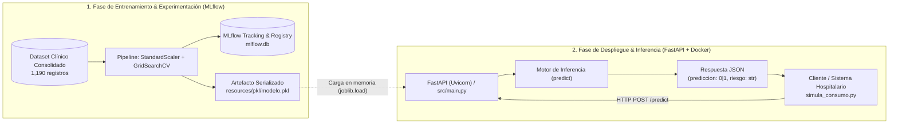
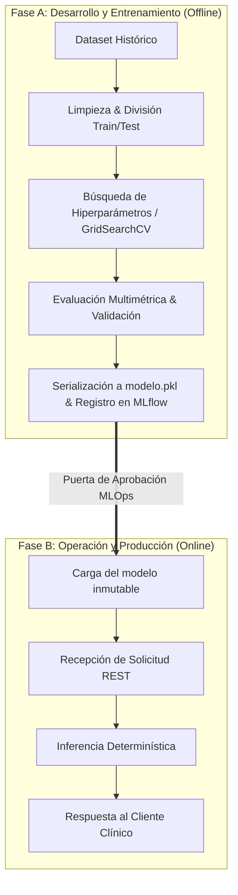
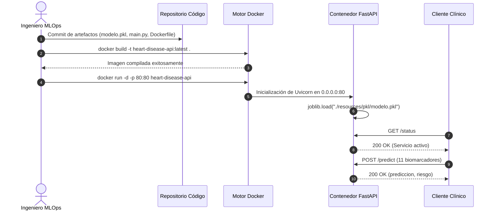

# Documentación Técnica de Despliegue
## Proyecto de Inteligencia Artificial (Alineado a ISO/IEC 23053:2022)

---

## 1. Información General del Documento

* **Nombre del proyecto:** Sistema Predictivo de Riesgo de Cardiopatía Isquémica (*Heart Disease Prediction Service*)
* **Versión del documento:** 1.0.0
* **Fecha:** 1 de noviembre de 2026
* **Responsables técnicos:**Carlos Villegas (Fase 2 - Maestría)
* **Organización / institución:** Programa de Maestría - Quinto Curso
* **Estado del proyecto:** Piloto / Prototipo Funcional Contenedorizado (FastAPI + Docker)

---

## 2. Introducción

### 2.1 Propósito del documento
Describir técnica y formalmente el despliegue del sistema de Inteligencia Artificial (IA), incluyendo su arquitectura, componentes, procesos operativos y consideraciones de mantenimiento, conforme al marco normativo **ISO/IEC 23053:2022** (*Framework for Artificial Intelligence Systems Using Machine Learning*). Esta norma internacional establece los componentes funcionales, las etapas del ciclo de vida y los flujos de datos en sistemas basados en Aprendizaje Automático (ML), proporcionando un estándar riguroso para la trazabilidad y la gobernanza en entornos productivos.

### 2.2 Alcance
Este documento técnico abarca:
* El sistema de IA en sus fases de **operación, inferencia y despliegue continuo**.
* La interconexión e interacción entre los componentes de datos, el pipeline de preprocesamiento, el modelo clasificador, el motor de inferencia y la API REST.
* La delimitación conceptual entre el ciclo de entrenamiento (*Data/Model Development*) y la etapa de inferencia (*Production Serving*).
* Las consideraciones técnicas, directrices de monitoreo de degradación (*data drift* / *concept drift*), salvaguardas éticas y protocolos de supervisión humana (*Human-in-the-Loop*).

---

## 3. Marco Normativo y Referencias

* **ISO/IEC 23053:2022:** *Information technology — Artificial intelligence — Framework for Artificial Intelligence (AI) Systems Using Machine Learning (ML)*.
* **ISO/IEC 22989:2022:** *Information technology — Artificial intelligence — Concepts and terminology*.
* **ISO/IEC 23894:2023:** *Information technology — Artificial intelligence — Guidance on risk management*.
* **Documentación interna del repositorio:**
  * Pipeline de experimentación y registro de artefactos: [`notebooks/Untitled-1.ipynb`](file:///c:/Users/carlo/Documents/Egresado/maestria/QuintoCurso/fase2/fase2/notebooks/Untitled-1.ipynb)
  * Registro de experimentos y metadatos: [`notebooks/mlflow.db`](file:///c:/Users/carlo/Documents/Egresado/maestria/QuintoCurso/fase2/fase2/notebooks/mlflow.db)
  * Artefacto serializado del modelo: [`resources/pkl/modelo.pkl`](file:///c:/Users/carlo/Documents/Egresado/maestria/QuintoCurso/fase2/fase2/resources/pkl/modelo.pkl)
  * Servicio de inferencia API REST: [`src/main.py`](file:///c:/Users/carlo/Documents/Egresado/maestria/QuintoCurso/fase2/fase2/src/main.py)
  * Cliente de prueba de consumo: [`src/simula_consumo.py`](file:///c:/Users/carlo/Documents/Egresado/maestria/QuintoCurso/fase2/fase2/src/simula_consumo.py)
  * Especificación de empaquetado y contenedor: [`Dockerfile`](file:///c:/Users/carlo/Documents/Egresado/maestria/QuintoCurso/fase2/fase2/Dockerfile)

---

## 4. Visión General del Sistema de IA
*(Alineado al componente "AI System Overview" de ISO/IEC 23053)*

### 4.1 Objetivo del sistema de IA
El sistema tiene como objetivo asistir en el triaje clínico y en la detección temprana del riesgo de enfermedad arterial coronaria / cardiopatía isquémica a partir de once (11) biomarcadores y variables clínicas no invasivas (tales como presión arterial, perfil lipídico, electrocardiograma en reposo y respuesta al esfuerzo físico). El valor generado radica en optimizar los tiempos de respuesta médica, reducir diagnósticos tardíos y proveer un soporte computacional objetivo para la priorización de estudios complementarios de cardiología de alta complejidad.

### 4.2 Tipo de sistema de IA
* **Categoría:** Basado en Machine Learning (ML).
* **Paradigma de aprendizaje:** **Supervisado** (Clasificación binaria probabilística).
* **Familia algorítmica:** Métodos de Ensamble (*Ensemble Learning*), específicamente Bosques Aleatorios (*Random Forest Classifier*) combinado con estandarización de características z-score mediante [`Pipeline`](https://scikit-learn.org/stable/modules/generated/sklearn.pipeline.Pipeline.html).

### 4.3 Actores involucrados
* **Usuarios finales:** Personal de salud (médicos cardiólogos, médicos generales y personal de enfermería en triaje) que consumen las alertas de riesgo para toma de decisiones asistida.
* **Operadores del sistema:** Ingenieros de MLOps y administradores de sistemas hospitalarios encargados de la ejecución, monitoreo de disponibilidad y orquestación del contenedor.
* **Administradores técnicos / Científicos de datos:** Responsables del ciclo de vida del modelo, reentrenamiento, auditoría de sesgo y gobernanza de datos.

---

## 5. Arquitectura del Sistema de IA
*(Elemento central del framework ISO/IEC 23053)*

### 5.1 Descripción de la arquitectura general
La arquitectura desacopla estrictamente el entorno de **entrenamiento y evaluación (*offline*)** del entorno de **inferencia y consumo (*online*)**, tal como estipula ISO/IEC 23053:



* **Componentes de datos:** Ingesta de vectores de características en formato tabular/numérico a través de solicitudes HTTP.
* **Componentes de ML:** Modelo binario exportado en formato Joblib que encapsula el preprocesamiento (`StandardScaler`) y la inferencia (`RandomForestClassifier`).
* **Componentes de operación y soporte:** Servidor ASGI Uvicorn ejecutado sobre un contenedor Docker Linux, exponiendo el puerto 80 para integración mediante API REST.

### 5.2 Componentes del sistema (según ISO/IEC 23053)

| Componente (ISO/IEC 23053) | Implementación en el Proyecto | Descripción Funcional |
| :--- | :--- | :--- |
| **Fuente de datos (*Data Source*)** | Solicitud HTTP de cliente clínico ([`src/simula_consumo.py`](file:///c:/Users/carlo/Documents/Egresado/maestria/QuintoCurso/fase2/fase2/src/simula_consumo.py)) | Provee los valores instantáneos de las 11 variables clínicas del paciente en tiempo real. |
| **Procesamiento de datos (*Data Processing*)** | Paso `scaler` en [`Pipeline`](file:///c:/Users/carlo/Documents/Egresado/maestria/QuintoCurso/fase2/fase2/resources/pkl/modelo.pkl) (`StandardScaler`) | Normaliza los atributos continuos a escala estándar ($z = (x - \mu)/\sigma$) empleando los parámetros calculados en el entrenamiento. |
| **Modelo ML (*ML Model*)** | `RandomForestClassifier` (`n_estimators=100`, `criterion='entropy'`) | Ensamble de 100 árboles de decisión que computa la votación ponderada para clasificar el riesgo del paciente. |
| **Motor de inferencia (*Inference Engine*)** | Método `.predict()` ejecutado en memoria RAM en el proceso de FastAPI | Transforma el vector numérico de entrada en una predicción binaria ($y \in \{0, 1\}$). |
| **Interfaz / API (*Interface / Serving Layer*)** | Endpoints FastAPI en [`src/main.py`](file:///c:/Users/carlo/Documents/Egresado/maestria/QuintoCurso/fase2/fase2/src/main.py) (`GET /status`, `POST /predict`) | Capa de comunicación que valida entradas, invoca al modelo y retorna la respuesta serializada en JSON. |
| **Infraestructura (*Infrastructure*)** | Imagen Docker basada en `python:3.9` ([`Dockerfile`](file:///c:/Users/carlo/Documents/Egresado/maestria/QuintoCurso/fase2/fase2/Dockerfile)) | Contenedorización reproducible para aislamiento de dependencias de sistema operativo, bibliotecas y puertos. |

---

## 6. Datos en el Entorno de Despliegue
*(Data development and use – ISO/IEC 23053)*

### 6.1 Tipos de datos utilizados en producción

#### A. Datos de entrada (*Input Features*)
El endpoint `POST /predict` requiere 11 variables clínicas:

| Parámetro | Tipo | Unidad / Rango Válido | Descripción Clínica |
| :--- | :--- | :--- | :--- |
| `age` | Entero | 18 a 100 años | Edad biológica del paciente. |
| `sex` | Entero | `{0, 1}` | Sexo biológico (1: Masculino, 0: Femenino). |
| `chest_pain_type` | Entero | `{1, 2, 3, 4}` | 1: Angina típica, 2: Angina atípica, 3: Dolor no anginoso, 4: Asintomático. |
| `resting_bp_s` | Entero / Flotante | 50 a 250 mm Hg | Presión arterial sistólica en reposo. |
| `cholesterol` | Entero / Flotante | 0 a 700 mg/dl | Nivel de colesterol sérico en sangre. |
| `fasting_blood_sugar`| Entero | `{0, 1}` | Glucemia en ayunas > 120 mg/dl (1: Verdadero, 0: Falso). |
| `resting_ecg` | Entero | `{0, 1, 2}` | Electrocardiograma: 0: Normal, 1: Anormalidad ST-T, 2: Hipertrofia ventricular. |
| `max_heart_rate` | Entero | 50 a 220 lpm | Frecuencia cardíaca máxima alcanzada en prueba de esfuerzo. |
| `exercise_angina` | Entero | `{0, 1}` | Angina inducida por el ejercicio (1: Sí, 0: No). |
| `oldpeak` | Flotante | -3.0 a 10.0 | Depresión del segmento ST inducida por esfuerzo relativo al reposo. |
| `ST_slope` | Entero | `{1, 2, 3}` | Pendiente del segmento ST pico de esfuerzo (1: Ascendente, 2: Plano, 3: Descendente). |

#### B. Datos de salida (*Output Features*)
Estructura JSON de respuesta generada:
```json
{
  "prediccion": 1,
  "riesgo": "Alto riesgo de enfermedad cardiaca"
}
```
* `prediccion`: Valor entero (`0`: sin indicio significativo, `1`: indicio patológico).
* `riesgo`: Etiqueta textual explicativa para consumo directo en interfaz de usuario.

#### C. Datos derivados (*Derived Data*)
* Matriz de atributos preprocesada $X_{norm}$ generada internamente por `StandardScaler`.
* Registro transaccional (*logs*) con código de estado HTTP y tiempo de latencia de cómputo.

### 6.2 Gestión de datos
* **Validación de datos en entrada:** Verificación de tipos en la capa de FastAPI y análisis de consistencia de rangos biológicos admisibles para mitigar valores anómalos antes de la inferencia.
* **Almacenamiento:** El servicio de inferencia opera en modo *stateless* (sin persistencia local de historias clínicas de pacientes en el contenedor), garantizando principio de minimización de datos.
* **Protección de datos (Privacidad y Ciberseguridad):** Cumplimiento de estándares de confidencialidad de datos médicos (HIPAA / RGPD). No se transmiten identificadores personales directos (nombre, cédula, teléfono) en el payload de predicción.
* **Periodos de retención:** Los logs de auditoría técnica del servidor se retienen por un período rotativo de 30 días para fines de análisis de fallas y detección de intrusiones.

---

## 7. Modelo de Machine Learning en Producción

### 7.1 Descripción del modelo
* **Algoritmo:** `RandomForestClassifier` implementado en `scikit-learn` dentro de un `Pipeline` serializado.
* **Hiperparámetros óptimos en despliegue (obtenidos vía `GridSearchCV` con scoring `f1`):**
  * `classifier__n_estimators`: `100`
  * `classifier__criterion`: `'entropy'`
  * `classifier__max_depth`: `None`
  * `classifier__min_samples_split`: `2`
  * `classifier__min_samples_leaf`: `1`
  * `random_state`: `42`
* **Métricas de desempeño en el conjunto de prueba independiente (238 muestras de prueba, 20% hold-out):**

| Métrica de Evaluación | Valor Obtenido | Interpretación en Contexto Clínico |
| :--- | :--- | :--- |
| **Exactitud (*Accuracy*)** | **94.54%** (0.9454) | Alta concordancia global diagnóstica. |
| **Precisión (*Precision*)** | **94.70%** (0.9470) | Tasa muy baja de falsos positivos en diagnósticos de alto riesgo. |
| **Sensibilidad / Exhaustividad (*Recall*)** | **95.42%** (0.9542) | Métrica crítica: detecta más del 95% de pacientes enfermos reales. |
| **F1-Score** | **95.06%** (0.9506) | Balance óptimo y armónico entre precisión y exhaustividad. |
| **Área bajo la curva ROC (*ROC-AUC*)** | **97.16%** (0.9716) | Capacidad discriminativa casi perfecta entre clases. |
| **Error Cuadrático Medio de Clases (*MSE*)** | **0.0546** | Bajo margen de clasificación errónea en clases discretas. |
| **Brier Score (*MSE en Probabilidades*)** | **0.0587** | Excelente calibración en la estimación de confianza probabilística. |

### 7.2 Ciclo de vida del modelo
ISO/IEC 23053 establece un principio fundamental: **la separación conceptual e instrumental entre la etapa de desarrollo/entrenamiento y la etapa de operación/despliegue**.



* **Versión actual:** `1.0.0-rf-entropy` (ejecutado bajo el run `16495a37e1da4eff85d229bab450f6ce` en MLflow).
* **Estrategia de actualización y reentrenamiento:**
  * Reentrenamiento programado trimestral o desencadenado por deriva estadística (*event-driven*).
  * Validación comparativa contra el modelo base mediante pruebas A/B o despliegue en modo sombra (*Shadow Deployment*).
* **Criterios de reemplazo y descarte del modelo:**
  * Si la sensibilidad (*Recall*) en validación médica decae por debajo de **0.90**.
  * Si el área bajo la curva (*ROC-AUC*) desciende por debajo de **0.92**.
  * En caso de incompatibilidad con nuevas versiones de bibliotecas de inferencia (`scikit-learn` / `joblib`).

---

## 8. Proceso de Despliegue del Sistema

### 8.1 Estrategia de despliegue
* **Patrón de servicio:** API REST síncrona en tiempo real (*Microservicio HTTP*).
* **Entorno de ejecución:** Contenedor Docker portable (apto para despliegue en servidor local, máquinas virtuales on-premise o servicios cloud como AWS ECS, Azure Container Apps o Google Cloud Run).

### 8.2 Pipeline de despliegue paso a paso



1. **Preparación del entorno:**
   * Verificación del archivo de dependencias y aislamiento del intérprete Python 3.9 en el [`Dockerfile`](file:///c:/Users/carlo/Documents/Egresado/maestria/QuintoCurso/fase2/fase2/Dockerfile).
   * Instalación de dependencias del runtime: `fastapi`, `uvicorn`, `scikit-learn`, `pandas`, `joblib`.
2. **Implementación del modelo:**
   * Verificación de integridad del binario [`resources/pkl/modelo.pkl`](file:///c:/Users/carlo/Documents/Egresado/maestria/QuintoCurso/fase2/fase2/resources/pkl/modelo.pkl).
   * Carga del modelo en memoria durante la inicialización de la aplicación FastAPI en [`src/main.py`](file:///c:/Users/carlo/Documents/Egresado/maestria/QuintoCurso/fase2/fase2/src/main.py).
3. **Configuración de servicios:**
   * Exposición del puerto `80` en el contenedor.
   * Ejecución mediante servidor ASGI: `uvicorn src.main:app --host 0.0.0.0 --port 80`.
4. **Validación postdespliegue:**
   * Comprobación de salud (*Health Check*): `GET /status`.
   * Ejecución del script de prueba end-to-end: [`python src/simula_consumo.py`](file:///c:/Users/carlo/Documents/Egresado/maestria/QuintoCurso/fase2/fase2/src/simula_consumo.py).

---

## 9. Operación, Monitoreo y Mantenimiento
*(Alineado a los principios de operación continua de ISO/IEC 23053)*

### 9.1 Monitoreo del sistema
* **Performance del modelo:** Auditoría muestral de diagnósticos emitidos frente al desenlace clínico real (contrastado con angiografías coronarias posteriores).
* **Calidad de entrada de datos (*Data Drift*):** Detección de desplazamientos en las distribuciones estadísticas de las variables (por ejemplo, cambios demográficos en la variable `age` o variaciones en mediciones de laboratorio en `cholesterol`).
* **Latencia y disponibilidad:** Seguimiento del percentil 95 (P95) de tiempo de respuesta (meta: $< 150 \text{ ms}$) y disponibilidad del contenedor (*Uptime* objetivo: $99.9\%$).

### 9.2 Mantenimiento
* **Procedimientos correctivos:**
  * En caso de caída del contenedor o error de memoria, reinicio automático a través de políticas de reinicio de Docker (`--restart unless-stopped`).
  * Procedimiento de *Rollback* inmediato a la imagen Docker previa en caso de fallas de inferencia.
* **Procedimientos preventivos:**
  * Actualización periódica de librerías base de Python para mitigar vulnerabilidades CVE conocidas.
  * Análisis de logs para detectar patrones recurrentes de solicitudes mal formadas (HTTP 422).
* **Gestión de incidentes:**
  * Clasificación de incidentes: **Severidad 1 (Crítico)** si la API no responde; **Severidad 2 (Mayor)** si hay degradación de métricas de desempeño; **Severidad 3 (Menor)** por advertencias en librerías.

---

## 10. Riesgos, Limitaciones y Supuestos
*(Elemento transversal del framework ISO/IEC 23053 e ISO/IEC 23894)*

### 10.1 Limitaciones técnicas conocidas
* El modelo fue entrenado con una base de datos consolidada de 1,190 pacientes. Aunque la métrica de generalización en prueba es alta (ROC-AUC 97.16%), la representatividad geográfica puede diferir de poblaciones hospitalarias con comorbilidades no registradas.
* Ciertos registros de la fuente original contienen valores de colesterol en `0` (indicador de dato no registrado o pérdida en recolección histórica), lo que requiere supervisión ante casos atípicos.

### 10.2 Riesgos de degradación del modelo (*Drift*)
* **Concept Drift:** Modificaciones en los criterios de diagnóstico clínico o en los protocolos farmacológicos que alteren la relación entre los síntomas y el estrechamiento arterial.
* **Data Drift:** Cambios en la tecnología de los electrocardiógrafos o tensiómetros que introduzcan diferencias de escala en variables como `oldpeak` o `resting_bp_s`.

### 10.3 Supuestos operativos
* Se asume que el personal médico o el sistema emisor valida previamente que los datos biomédicos ingresados correspondan fehacientemente al paciente evaluado.
* Se asume conectividad interna de red estable entre la intranet hospitalaria y el microservicio de inferencia.

---

## 11. Consideraciones Éticas y de Uso Responsable

### 11.1 Riesgos de sesgo (*Bias & Fairness*)
* **Sesgo de género:** Históricamente, los síntomas de la enfermedad arterial coronaria se manifiestan de forma diferente en mujeres que en hombres. En el dataset de entrenamiento, el 76.4% de los registros corresponden a hombres y el 23.6% a mujeres. Se debe auditar de forma segmentada la sensibilidad por sexo para evitar disparidades de error de diagnóstico.
* **Sesgo etario:** El modelo está optimizado para pacientes adultos (rango de 28 a 77 años); su aplicación en pacientes pediátricos o geriátricos extremos carece de validez clínica.

### 11.2 Impacto en usuarios
* Un falso positivo genera ansiedad en el paciente y posibles costos en pruebas invasivas innecesarias.
* Un falso negativo es el escenario de mayor gravedad clínica, al retrasar un tratamiento cardiovascular vital. Por ello, la optimización priorizó el *Recall* (95.42%).

### 11.3 Restricciones de uso
* **ADVERTENCIA MÉDICA:** El presente sistema es una **herramienta de asistencia y triaje**, y bajo ninguna circunstancia reemplaza el juicio clínico, el diagnóstico formal ni la prescripción médica de un profesional de la salud matriculado.

### 11.4 Supervisión humana (*Human-in-the-Loop*)
* Todo resultado emitido por la API debe ser presentado al médico tratante como una recomendación asistida ("Alto riesgo" o "Bajo riesgo"). La decisión de ordenar estudios invasivos o dar de alta al paciente recae exclusivamente en el médico.

---

## 12. Trazabilidad y Versionado

### 12.1 Matriz de trazabilidad
* **Versión del código fuente:** `1.0.0`
* **Commit / Rama:** `main`
* **Identificador de ejecución MLflow (*Run ID*):** `16495a37e1da4eff85d229bab450f6ce`
* **Experimento MLflow:** `Clasificacion Heart decesease Arbol`
* **Ruta del artefacto de modelo:** [`resources/pkl/modelo.pkl`](file:///c:/Users/carlo/Documents/Egresado/maestria/QuintoCurso/fase2/fase2/resources/pkl/modelo.pkl)

### 12.2 Historial de cambios

| Versión | Fecha | Autor / Responsable | Descripción del Cambio |
| :--- | :--- | :--- | :--- |
| `0.1.0` | Octubre 2026 | Equipo de Ciencia de Datos | Análisis exploratorio y entrenamiento inicial en notebook Jupyter. |
| `0.2.0` | Octubre 2026 | Equipo MLOps | Búsqueda por grilla (`GridSearchCV`), logging en MLflow y exportación a pickle. |
| `1.0.0` | Noviembre 2026 | Equipo de Ingeniería de Software | Implementación de API REST con FastAPI, Dockerfile y documentación bajo ISO/IEC 23053:2022. |

---

## 13. Glosario de Términos
*(Conforme a la terminología normalizada de ISO/IEC 23053:2022 e ISO/IEC 22989:2022)*

* **Aprendizaje Automático (*Machine Learning - ML*):** Proceso mediante el cual un sistema computacional genera modelos a partir de datos para realizar tareas sin haber sido programado con instrucciones de reglas explícitas para dicha tarea.
* **Ciclo de vida del sistema de IA (*AI System Life Cycle*):** Evolución temporal del sistema de IA desde su concepción, adquisición de datos, entrenamiento, validación, despliegue, operación, monitoreo hasta su retiro.
* **Deriva conceptual (*Concept Drift*):** Cambio imprevisto o progresivo en las propiedades estadísticas de la variable objetivo o en la relación funcional entre las variables de entrada y la salida.
* **Deriva de datos (*Data Drift*):** Variación en la distribución de probabilidad de las variables de entrada del modelo a lo largo del tiempo respecto al conjunto de entrenamiento.
* **Inferencia (*Inference*):** Proceso de aplicar un modelo entrenado a nuevos datos no observados para generar una estimación, clasificación o predicción.
* **Pipeline:** Secuencia orquestada de operaciones de procesamiento de datos, transformaciones de características y algoritmos predictivos vinculados linealmente.
* **Random Forest:** Algoritmo de aprendizaje supervisado de ensamble que combina múltiples árboles de decisión independientes entrenados sobre subconjuntos aleatorios de datos y características (*bagging*).
* **Supervisión humana (*Human-in-the-loop - HITL*):** Esquema de gobernanza donde las decisiones generadas por sistemas de IA están sujetas a la revisión, validación o anulación por parte de un operador humano.

---

## 14. Anexos Técnicos

### 14.1 Estructura del repositorio

```text
fase2/
├── Dockerfile                   # Definición de contenedor Docker
├── README.md                    # Documentación técnica ISO/IEC 23053:2022
├── notebooks/
│   ├── Untitled-1.ipynb         # Pipeline de experimentación y entrenamiento
│   └── mlflow.db                # Base de datos de tracking de MLflow
├── resources/
│   ├── archiv52e/
│   │   └── heart_statlog_cleveland_hungary_final.csv  # Dataset unificado
│   └── pkl/
│       └── modelo.pkl           # Artefacto binario del pipeline entrenado
└── src/
    ├── main.py                  # API REST FastAPI para inferencia
    └── simula_consumo.py        # Script cliente de prueba de la API
```

### 14.2 Instrucciones de ejecución

#### A. Ejecución local con Python

1. Clonar el repositorio y ubicarse en la raíz del proyecto.
2. Instalar las dependencias necesarias:
   ```bash
   pip install fastapi uvicorn scikit-learn pandas joblib requests
   ```
3. Iniciar el servicio web de la API:
   ```bash
   uvicorn src.main:app --host 0.0.0.0 --port 8000 --reload
   ```
4. Consultar el estado del servicio:
   * URL de estado: `http://localhost:8000/status`
   * Documentación interactiva Swagger: `http://localhost:8000/docs`
5. Ejecutar la simulación de consumo:
   ```bash
   python src/simula_consumo.py
   ```

#### B. Construcción y ejecución mediante Docker

1. Construir la imagen del contenedor:
   ```bash
   docker build -t heart-disease-api:1.0.0 .
   ```
2. Ejecutar el contenedor mapeando el puerto 80:
   ```bash
   docker run -d -p 80:80 --name servicio-cardiaco heart-disease-api:1.0.0
   ```
3. Verificar los logs de inicio del contenedor:
   ```bash
   docker logs -f servicio-cardiaco
   ```
4. Realizar una solicitud de prueba mediante cURL:
   ```bash
   curl -X POST "http://localhost/predict?age=49&sex=1&chest_pain_type=4&resting_bp_s=140&cholesterol=234&fasting_blood_sugar=0&resting_ecg=0&max_heart_rate=140&exercise_angina=1&oldpeak=1.0&ST_slope=2"
   ```
   **Respuesta esperada:**
   ```json
   {
     "prediccion": 1,
     "riesgo": "Alto riesgo de enfermedad cardiaca"
   }
   ```
